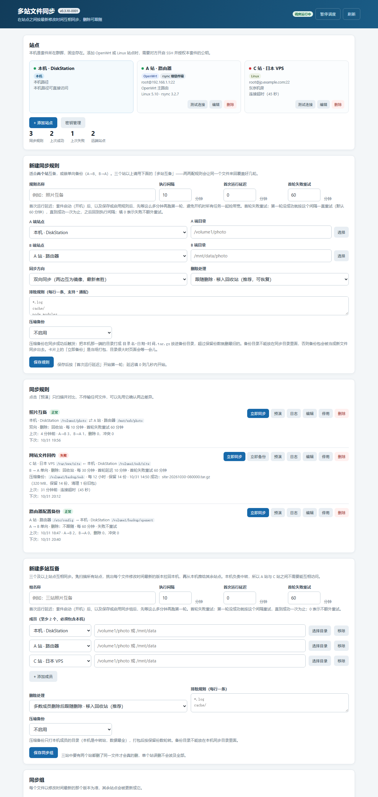

# 多站文件同步（FileSync）

群晖 DSM 套件：在本机 NAS 与 OpenWrt 路由器 / Linux 服务器之间，按「最新修改时间」双向同步指定目录。

**只传有变化的文件；三站时间强制一致；三站都没更新时只扫描、不传输。**

**版本 0.3.17** · 平台 DSM 7.x · 架构 x86_64 · 作者 [AWA](https://www.akkdiy.cn)



---

## 它解决什么问题

家里或公司常有这样几台机器：

- **B：群晖 NAS** —— 存照片、文档的主机
- **A：OpenWrt 路由器** —— 只有 BusyBox，装不了 SPK，但能 SSH
- **C：Linux VPS / 另一台服务器** —— 在异地

想让三台机器上某个目录始终一致，但：

- 路由器装不了套件，也不能直连 VPS；
- `rsync --delete` 是单向的，两边各跑一次会互相删掉对方的新文件；
- 全量同步太慢，还会把没变的文件重复传一遍。

FileSync 的做法是：**套件只装在 B（群晖）上，B 作为中转站**，用 SSH 驱动 A 和 C。每轮先扫描三站，按文件粒度比较，只处理有变化的文件——从最新的那一站拉回 B，再推给另外两站。A 和 C 之间不需要直连。

## 核心特性

- **按文件粒度同步**：只传新增/修改的文件；三站都一致时只扫描，不拉取、不推送。
- **最新者胜**：同一文件多处修改时，以修改时间最新的版本为准。
- **时间强制一致**：传输完成后把目标文件的 mtime 统一为权威值，不依赖 rsync/tar 是否保留时间，避免「传输改时间 → 下轮又判差异 → 反复重传」。
- **删除多数决**：三站里两站删了才真的删；1 删 2 存会把文件推回去，防止误删扩散。
- **冲突留副本**：覆盖前把落败版本移入 `.filesync-trash/conflicts/`，可恢复。
- **SSH 免密**：密钥只在本机生成，私钥不出群晖；一键生成安装命令，OpenWrt 与 Linux 通用。
- **rsync 增量 + tar 降级**：远端有 rsync 用 `--files-from` 精确传输，没有就自动降级 tar 流。
- **目录选择器**：不用手敲路径，弹窗里逐级选择；**本机目录走 DSM FileStation 接口（借当前登录管理员会话）浏览，所以 `/volume1/homes` 这类只有 root 能列的目录也能正常进入**；远端站点仍走 SSH，只列直接子目录、不递归扫描。
- **排除规则**：`*.log`、`cache/` 等按 glob 排除；`@eaDir`、`#recycle` 等系统目录自动跳过。
- **首次运行延迟**：套件启动（开机）后、以及保存或启用任务后，先等 N 分钟再跑第一轮，避免开机时所有任务一起抢带宽。
- **首轮失败重试**：第一轮失败（公钥没装好、对方还没开机）就按设定间隔（默认 60 分钟）重试，直到成功一次为止，之后回到正常执行间隔。
- **主机目录压缩备份**：同步成功后把本机目录打成 `目录名-日期-时间.tar.gz` 放进另一个目录，按保留份数自动轮转，留一份不受同步覆盖影响的时间点快照。

## 系统要求

| 项 | 要求 |
| --- | --- |
| 群晖 | DSM 7.0-40000 及以上，x86_64 |
| 远端 | Linux 或 OpenWrt，能 SSH 登录（建议 root） |
| 远端依赖 | `find`、`stat`、`tar` 必装；`rsync` 可选（有则更快） |
| 网络 | 群晖能 SSH 到远端对应端口 |
| 本机权限 | 调度进程以 root 运行（`postinst` 会把已安装的 `conf/privilege` 里 `run-as` 改成 `root`——DSM 7 不允许在 spk 里直接声明 root，但运行时读已安装文件，改完重启即生效），这样才能读写 `/volume1/homes` 这类只有 root 能进的目录 |

## 安装教程

1. 到 [Releases](https://github.com/awahello/synology-filesync/releases) 下载最新的 `synology-filesync-x.y.z.spk`。
2. 群晖 **套件中心 → 手动安装**，选择该 spk。
3. 安装完成后打开「多站文件同步」。

> 覆盖安装会保留站点、规则、同步组和密钥，不需要重新配置。

## 快速开始：三站互备

以「本机 NAS + web 服务器 + openwrt 路由」为例。

### 1. 添加站点

「站点」→「新建站点」，填写：

- **名称**：如 `web`
- **类型**：远端选 `SSH`，本机会自动识别为「本机」
- **地址 / 端口 / SSH 用户**：如 `192.168.1.10`、`22`、`root`
- **使用的密钥**：保存时会自动生成或补一个

### 2. 安装公钥（只做一次）

1. 点「密钥管理」→ 找到对应密钥 →「复制安装命令」。
2. 到远端机器的终端**粘贴执行**，看到 `OK` 即可。
   - 这条命令会同时写入 `/etc/dropbear/authorized_keys`（OpenWrt）和 `~/.ssh/authorized_keys`（Linux）。
   - 重复执行不会写重复。

### 3. 测试连接

在站点卡片点「测试连接」，能返回系统信息和 rsync 状态就说明通了。

### 4. 新建多站互备

「新建多站互备」：

- **组名称**：如 `三站照片互备`
- **执行间隔**：如 `10` 分钟
- **成员**：至少 2 个，**必须包含本机**；每行选站点 + 目录
- **删除处理**：多数成员删除后跟随删除 · 移入回收站（推荐）
- **排除规则**：可选

### 5. 先预演，再同步

- 点「预演」：只扫描对比，不传输，确认差异符合预期。
- 点「立即同步」：执行一次。
- 之后按间隔自动执行。

## 界面说明

界面自上而下分为六块：

### 顶部

版本号、**立即同步**、**密钥管理**、刷新。

### 站点

每个站点一张卡片，显示名称、类型、地址和系统信息。

- **测试连接**：探测 SSH 与 rsync 能力。
- **编辑 / 删除**：修改或移除站点。
- **新建站点**：添加本机或远端。

### 新建同步规则（两站）

适合「本机 ↔ 某一台远端」的点对点同步。

| 字段 | 说明 |
| --- | --- |
| 规则名称 | 便于识别 |
| 执行间隔 | 分钟，1–10080 |
| 首次运行延迟 | 分钟，开机（套件启动）后与保存后都先等这么久再跑第一轮；0 = 立即 |
| 首轮失败重试 | 分钟，第一轮失败后按此间隔重试，直到成功一次为止；0 = 不额外重试 |
| A 端 / B 端站点与目录 | 两端路径，可点「选择」用目录选择器 |
| 同步方向 | 双向 / 仅 A→B / 仅 B→A |
| 删除处理 | 回收站 / 直接删除 / 不跟随 |
| 排除规则 | 每行一条，支持 `*` 通配 |
| 压缩备份 | 可选。启用后填备份目录、保留份数、备份间隔（小时）、备份延迟（分钟，默认 5），见下方「压缩备份」 |

### 同步规则

列出所有两站规则，每条可「立即同步 / 预演 / 日志 / 编辑 / 删除」。

### 新建多站互备（三站及以上）

| 字段 | 说明 |
| --- | --- |
| 组名称 | 如 `三站照片互备` |
| 执行间隔 | 分钟 |
| 首次运行延迟 / 首轮失败重试 | 同两站规则 |
| 压缩备份 | 可选，打包的是本机成员那一端的目录 |
| 成员 | 至少 2 个，必须含本机；每个成员选站点 + 目录，可「选择目录」「移除」 |
| 删除处理 | 多数成员删除后跟随删除 |
| 排除规则 | 每行一条 |

### 同步组

列出所有多站互备组，同样支持「立即同步 / 预演 / 日志 / 编辑 / 删除」。

### 同步设置

- **回收站保留天数**：`.filesync-trash` 下超过天数的内容自动清理，0 表示永久保留。
- **冲突处理**：覆盖前是否保留败方副本（推荐保留）。

## 压缩备份（可选）

同步解决的是「几台机器保持一致」，压缩备份解决的是「本机留历史快照」——同步可能被另一端的旧版本覆盖，只有压缩包才是时间点上的原始副本。

- **触发**：每轮同步成功后**先等「备份延迟」（默认 5 分钟）再打包**，让刚同步完、可能还在落盘的文件稳定下来，也避免和同步抢磁盘 IO；同时距上次备份超过「备份间隔（小时）」才会真正打包，所以不会跟着每 10 分钟的同步反复压缩。
- **位置**：本机目录 → 备份目录，文件名 `目录名-YYYYmmdd-HHMMSS.tar.gz`。
- **轮转**：只保留最新的「保留份数」份，多出来的自动删除；只清理自己产生的文件名，备份目录里你放的其它文件不会被碰。
- **排除**：沿用该任务的排除规则，并自动跳过 `@eaDir`、`#recycle`、`.filesync-trash` 等目录。
- **手动**：规则/同步组卡片上的「立即备份」可随时打一次，不受间隔限制。0.3.17 起手动备份也**排给调度进程（root）执行**，20 秒内完成、结果写回卡片（网页端本身没权限写 `/volume1/homes`，不能当场打包）。
- **注意**：备份目录不能放在同步目录里面，否则备份包会被当成新文件同步出去，套件会直接拒绝这种配置。

## 同步逻辑

### 两站规则

用「上次同步基线」做三向比较：

- 一端新增 → 复制到另一端
- 一端删除 → 按删除策略跟随或推回
- 两端都改 → 修改时间新的胜出，旧的留副本

### 多站互备（N 路）

每轮：

1. **扫描**全部成员，得到每个文件的 `大小 + 修改时间`。
2. **决策**：逐文件挑出最新版本作为权威；三站一致的直接跳过。
3. **阶段一**：把权威版本拉回本机（只拉有差异的）。
4. **阶段二**：从本机推给其余成员（只推有差异的）。
5. **阶段三**：处理删除（多数决）。
6. **统一时间**：把传输过的文件 mtime 设为权威值，三站一致。

**删除为什么用多数决**：三站里 A 误删一个文件，如果「任一删除即跟随」，B、C 会立刻跟着删，一次误操作波及全部。改成多数决后，2 站删除才真的删，1 删 2 存则把文件推回去。

## 常见问题

**Q：远端提示 `Permission denied (publickey)`？**
公钥没装好。到「密钥管理」重新复制安装命令，到远端执行；或用 `cat >> ~/.ssh/authorized_keys` 单独粘贴公钥，注意不要被终端折行截断。

**Q：选目录时提示「没有权限访问：/volume1/homes」？**
`/volume1/homes` 这类目录是 `root:root 711`——能进去、但不允许列内容。**0.3.15 起，本机目录选择器改走 DSM FileStation 接口**（`SYNO.FileStation.List`，由浏览器带着当前登录管理员会话调用），所以能正常逐级浏览 `homes`，不再依赖套件服务端权限——这和「数据库自动备份」套件用的是同一个办法。
而**实际同步**仍需调度进程有读权限：0.3.12 起安装/升级时 `postinst` 会把**已安装**的 `conf/privilege` 里 `run-as` 改为 `root`，于是调度进程以 root 运行，能读取这类目录。这是 DSM 7 社区通用做法（Jellyfin、Zerotier 等同理），因为 DSM 不允许未签名套件在 spk 里直接声明 root，但运行时读的是已安装文件，改完重启即生效。

**已经装了 0.3.11 或更早、不想重装？** SSH 登录群晖（用管理员或 root），执行一次即可，不必重装：

```sh
sed -i 's/"run-as": "package"/"run-as": "root"/' /var/packages/FileSync/conf/privilege
synopkg restart FileSync
```

如果仍然报错，看错误信息里是否出现「调度进程未以 root 运行（当前 uid N）」：出现这句说明 `run-as` 没改成 root。按上面的命令再执行一次，并确认 `/var/packages/FileSync/conf/privilege` 里 `run-as` 已经是 `root`。改成功后，到「套件中心 → 多站文件同步 → 查看日志」，应出现 `目录代读服务已就绪（uid=0）`。

**Q：浏览目录时提示「调度进程忙（可能正在同步），请稍后再试」？**
0.3.13 起，目录代读由调度进程里的**独立后台线程**常驻服务，主线程在跑同步时也不会卡住浏览。若仍偶尔出现，说明这一版之前的老进程还在（升级后需重启套件），重启一次即可；同步本身不受影响。

**Q：备份显示「失败：打包失败…」？**
网站目录、日志目录这类文件一直在变的地方，`tar` 打包时遇到文件被改动/消失会返回**退出码 1**——这是警告不是错误，包本身仍然完整可用。**0.3.16 起已把退出码 1 当作成功处理**，只有退出码 ≥2 才报错。如果仍失败，点卡片上的「日志」看具体原因：
- 出现「没有权限创建备份目录」→ 调度进程没以 root 运行（备份到 `/volume1/homes` 需要 root），重装或重启套件让 `run-as:root` 生效；
- 出现「本机目录不可用」→ 该同步组的本机成员目录填错了或不存在。

**Q：OpenWrt 上「测试连接」失败？**
检查 `/etc/config/dropbear` 是否允许 root 登录（`option RootLogin '1'`），以及 `/etc/dropbear/authorized_keys` 权限是否为 `600`。

**Q：为什么第一次同步会传一批文件？**
第一次没有基线，会把三站之间不一致的文件都同步一遍；之后只传真正变化的。如果只是时间不同、内容一样，也会在这一轮被统一时间。

**Q：三站时间会不会因为传输而改变？**
不会。0.2.4 起，传输后会把目标文件 mtime 强制设为权威值（本机 `os.utime`，远端 `TZ=UTC touch -t`），三站一致。

**Q：同一目录能不能同时用于「同步规则」和「同步组」？**
不要。两套基线会互相冲突，建议一个目录只归一种任务。

## 免责声明

本套件按「现况」提供，用于辅助文件同步，**不保证**在所有文件系统、权限、网络环境下都能完整同步、正确判定冲突或成功恢复。使用者须自行检查每次任务结果，**保留独立备份**，并定期实际测试恢复流程。因使用本套件导致的文件丢失、覆盖、服务中断或间接损失，作者不承担责任。

完整声明见 [DISCLAIMER.txt](DISCLAIMER.txt)。

## 许可

Copyright (c) 2026 AWA · [www.akkdiy.cn](https://www.akkdiy.cn)。保留所有权利。

本仓库仅供审阅与个人评估；未经作者书面许可，不得复制、修改、再发布、转授权或用于商业服务。详见 [LICENSE](LICENSE)。
